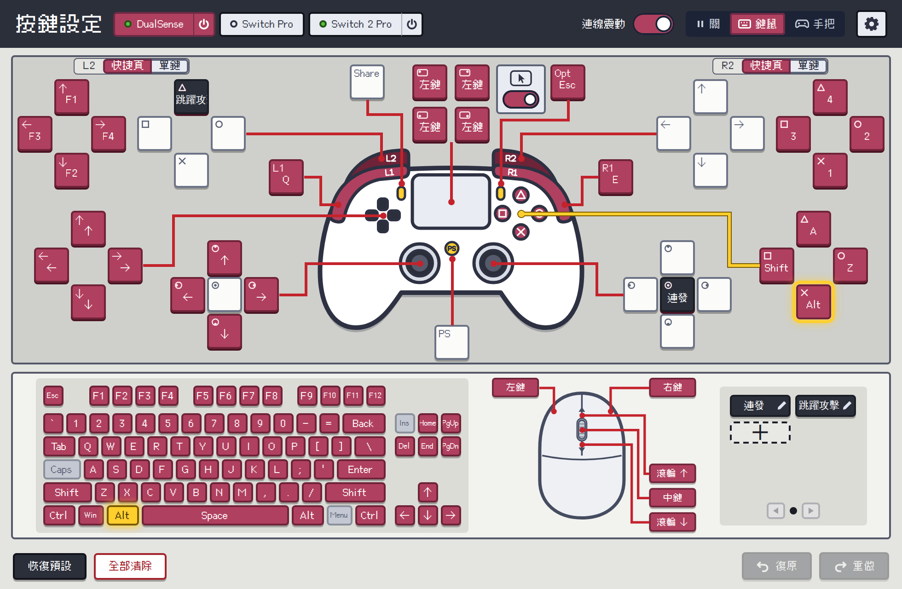
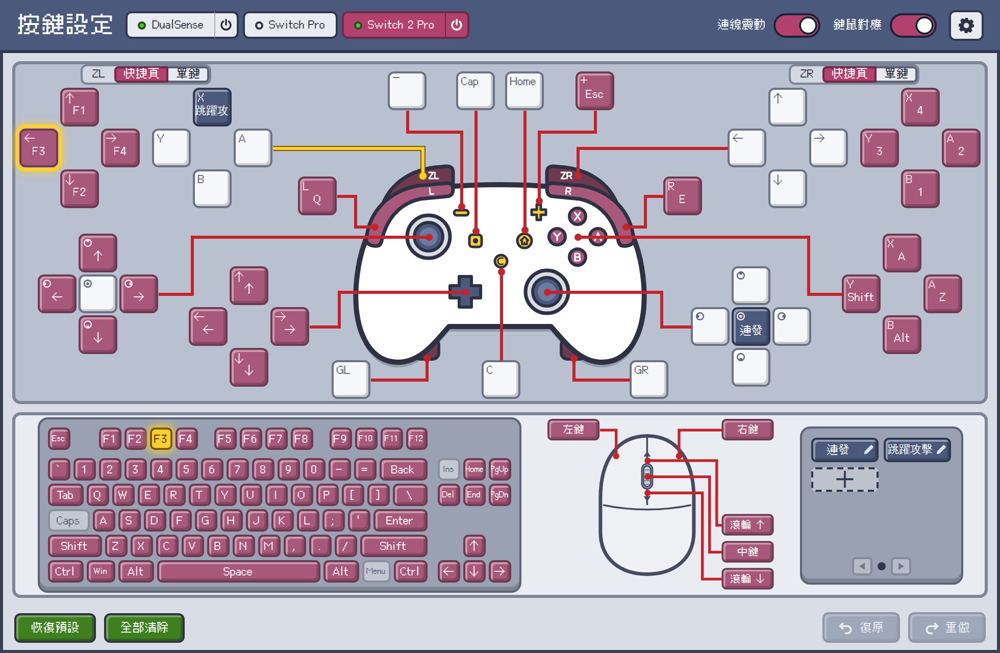
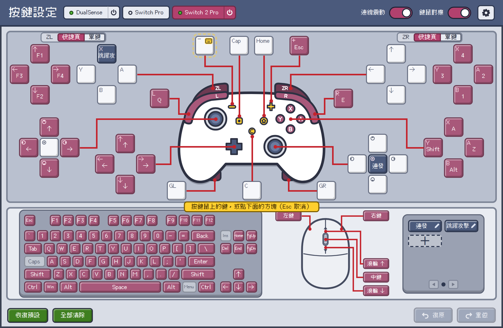
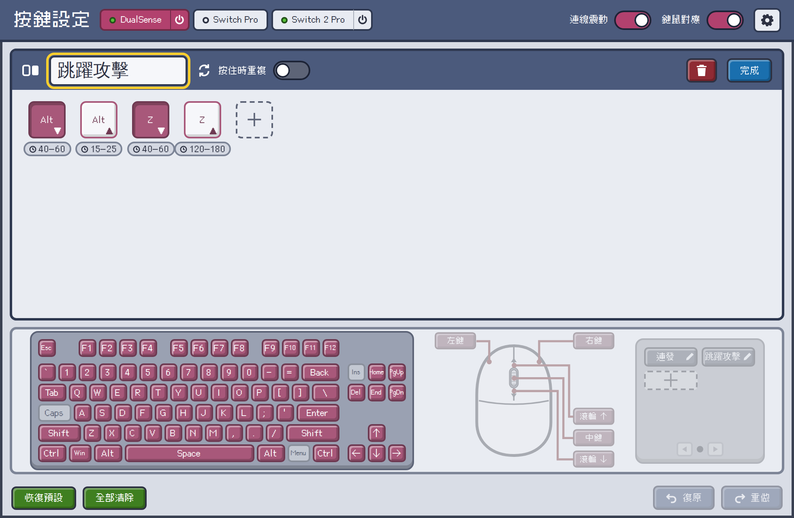
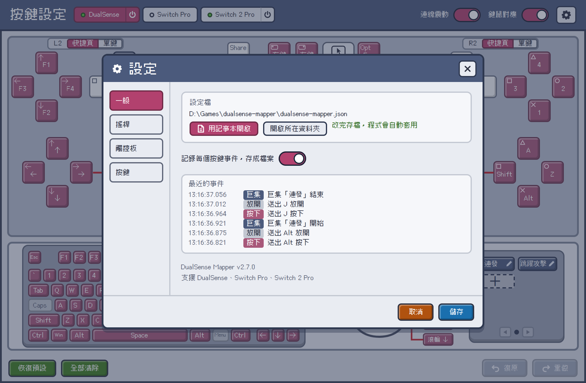

# PadToKBM 手把轉鍵鼠

**把手把變成鍵盤和滑鼠：只吃鍵鼠的遊戲，也能拿手把玩。**

<p align="center">
  
</p>
<p align="center"><sub>按鍵設定畫面：把鍵盤、滑鼠或巨集方塊拖到按鈕的格子上就綁好了。按下的按鈕和它送出的鍵會亮起來。</sub></p>

PadToKBM（舊名 DualSense Mapper）是一個 Windows 小程式：一個約 11 MB 的 `PadToKBM.exe`，不用安裝、沒有驅動。
支援 **DualSense（PS5）、Switch Pro、Switch 2 Pro** 三種手把，每支各自一套按鍵設定。
最初是為了讓我太太在筆電上用手把玩 MapleStory Worlds Artale 而寫的。

目前版本見 [CHANGELOG.md](CHANGELOG.md)。

---

## 它幫你解決什麼

| 麻煩 | PadToKBM 怎麼處理 |
|---|---|
| 遊戲只吃鍵盤滑鼠，不認手把 | 手把按鍵送出鍵盤按鍵、滑鼠按鍵和滾輪；DualSense 的觸控板可以當滑鼠游標 |
| 改設定檔綁鍵很麻煩 | 用拖的：方塊拖到格子就綁好，格子拖到另一格就交換，拖出去就清掉；可以復原／重做 |
| 按鍵不夠用 | **快捷頁**：按住 L2／ZL（或 R2／ZR）時，十字鍵和四顆面鍵換成另一組 8 個鍵 |
| 一鍵連發、固定招式要按很多下 | **巨集**：錄一串按下／放開，可以循環；每一步的延遲都是「最短～最長」的範圍 |
| 怕被當成腳本或外掛 | 所有按鍵時間都帶隨機，沒有固定節拍；只用 Windows 一般的按鍵輸入，不注入、不改遊戲 |
| 鍵卡住放不開 | 手把斷線、關掉程式、程式當掉時，按著的鍵都會放開 |

---

## 三步開始

**1. 下載**：到 [最新版本](https://github.com/Luotee/pad-to-kbm/releases/latest) 下載 `PadToKBM.exe`，放進一個你可以寫入的資料夾（例如 `下載\PadToKBM\`）。

**2. 配對手把（藍牙）**

| 手把 | 怎麼配對 |
|---|---|
| DualSense | 同時按住 PS 鍵和 Create 鍵到燈條閃爍，再到 Windows「藍牙與裝置」加入 |
| Switch Pro | 按住頂端的配對鍵到燈號跑動，再到 Windows「藍牙與裝置」加入 |
| Switch 2 Pro | **不要**在 Windows 裡配對。開著 PadToKBM，第一次按住手把上的小 SYNC 鍵；之後按任一鍵就會連上 |

**3. 雙擊 `PadToKBM.exe`**：視窗打開後按手把試試，對應的鍵會送到目前在前景的程式。
第一次執行會在 exe 旁邊寫一份設定檔 `padtokbm.json`；整個資料夾可以直接搬到別台電腦用。

---

## 介面一覽

<table>
  <tr>
    <td width="50%"></td>
    <td width="50%"></td>
  </tr>
  <tr>
    <td><sub><b>快捷頁。</b>按住 ZL 時，十字鍵和面鍵改用這一頁（這裡 ← 送出 F3）。每個扳機都能切換「快捷頁」或「單鍵」。</sub></td>
    <td><sub><b>按一下就綁。</b>點格子，再按鍵盤或滑鼠（中鍵、右鍵、滾輪），或點下方的方塊。Esc 取消。</sub></td>
  </tr>
  <tr>
    <td></td>
    <td></td>
  </tr>
  <tr>
    <td><sub><b>巨集。</b>點鍵盤的鍵加步驟，拖曳排順序，拖出去刪除。</sub></td>
    <td><sub><b>設定</b>（齒輪）：設定檔與最近的事件、搖桿校正、觸控板、按鍵時間，按「儲存」才套用。</sub></td>
  </tr>
</table>

<sub>截圖用的是示範設定，可用 <code>scripts/readme-shots.mjs</code> 重新產生。</sub>

---

## 常見問題

### 會不會被當成外掛？

它只做「手把按鍵 → 鍵盤按鍵」，跟你自己按鍵盤一樣，用的是 Windows 一般的按鍵輸入（`SendInput`），不注入程式、不改遊戲檔、不裝驅動。
為了不像腳本，按住時間（`min_press_ms`）、同時按下的錯開（`tick_jitter_ms`）、巨集每一步的延遲都是隨機範圍，不能設成固定值。
要自己檢查的話，把設定的「記錄每個按鍵事件」打開，每個送出的鍵都會連同時間寫進檔案。

### Switch 2 Pro 連上了，遊戲卻沒反應？

Switch 2 Pro 預設是**不轉鍵鼠**：PadToKBM 把它變成一支虛擬 Xbox 手把給遊戲用，這需要先安裝
[ViGEmBus 1.22.0](https://github.com/nefarius/ViGEmBus/releases/tag/v1.22.0)。想讓它送鍵盤按鍵，把畫面上方的「鍵鼠對應」打開。
建議用 Windows 11（Windows 10 的藍牙會把它限制在約 17 Hz）。

### 設定檔在哪？可以直接改嗎？

在 exe 旁邊的 `padtokbm.json`。設定視窗的「一般」分頁有「用記事本開啟」；改完存檔，程式會自動套用。檔案開頭附有可用的鍵名對照。

### 從 DualSense Mapper（v3.0.0 以前）升級，設定會不見嗎？

不會。把 `PadToKBM.exe` 放進原本的資料夾、刪掉舊的 `dualsense-mapper.exe`，第一次執行時舊的 `dualsense-mapper.json`
會自動改名成 `padtokbm.json`，另外留一份 `dualsense-mapper.json.bak` 備份。

### 不想用的時候可以把手把關掉嗎？

可以，點手把名稱旁的電源鍵。配對會保留，按 PS／HOME 鍵就能再連上。

### 支援 USB、DualSense Edge、Xbox 手把或 macOS 嗎？

目前不支援：只走藍牙，Windows 限定。macOS 版還在計畫中；那之前 macOS 可以用 [`legacy-python/`](legacy-python/README.md) 的舊版 Python 程式（只支援 DualSense）。

---

## 開發者資訊

<details>
<summary><b>建置、測試、目錄</b></summary>

| 目錄 | 內容 |
|---|---|
| `rust/` | 主程式（Rust + Tauri）；前端在 `rust/web/` |
| `scripts/` | `verify.sh`（發版前驗證）、截圖、字型與 icon 產生器 |
| `legacy-python/` | 2025 年 5 月的 Python 原型，凍結不改 |

```bash
cd rust
cargo test                               # Linux 開發機需要 pkg-config + libudev-dev
WEBVIEW2_STATIC=true cargo xwin build --release \
  --target x86_64-pc-windows-msvc --features gui   # → PadToKBM.exe
cd .. && scripts/verify.sh               # 四層驗證：linux / windows-tests / gui-smoke / web
```

命令列參數（主要給除錯用）：`--config PATH`、`--validate`、`--dry-run`（只印出要送的鍵，不真的按）、`--list-buttons`、`--verbose`、`--cli`（舊的主控台模式）、`--no-pause`。

設定檔裡每支手把的 `buttons` 都要列滿按鍵 id 0～32；各 id 對應的按鈕見 [`rust/config.example.json`](rust/config.example.json) 的 `label`。
貢獻規則與不能破壞的設計原則見 [CLAUDE.md](CLAUDE.md)。

</details>
