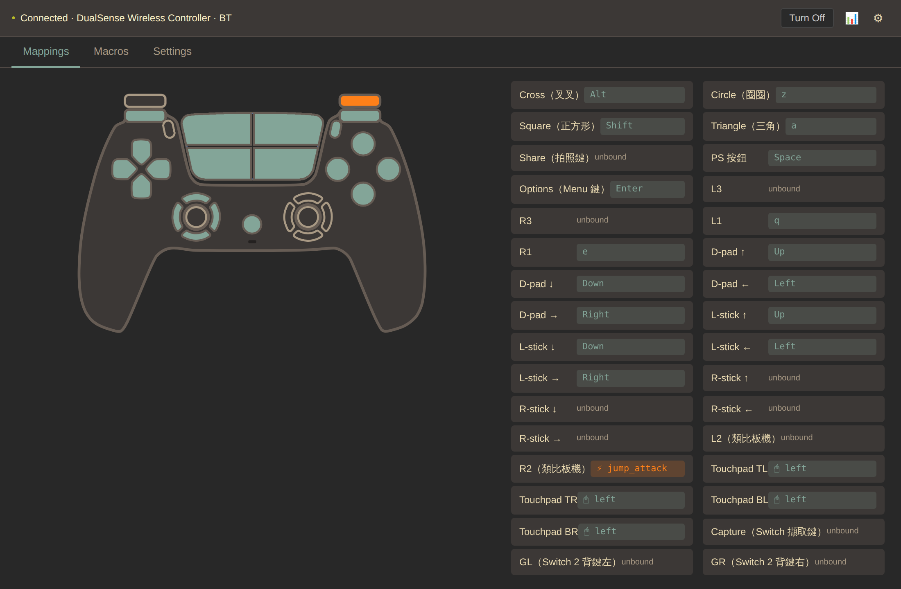
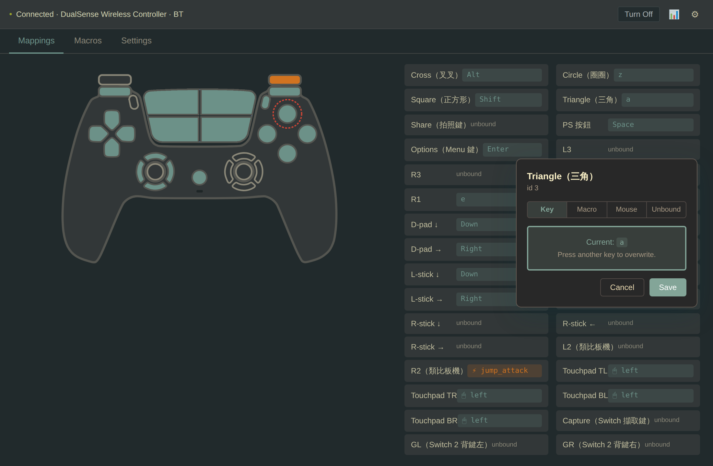
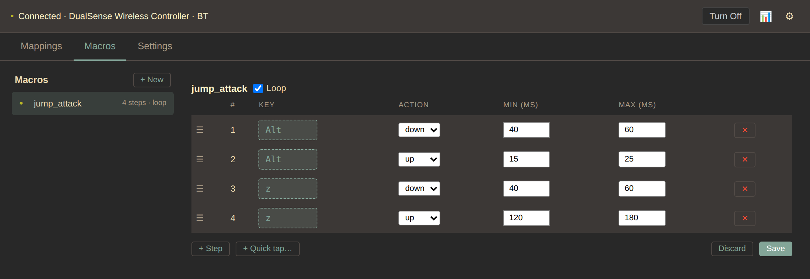
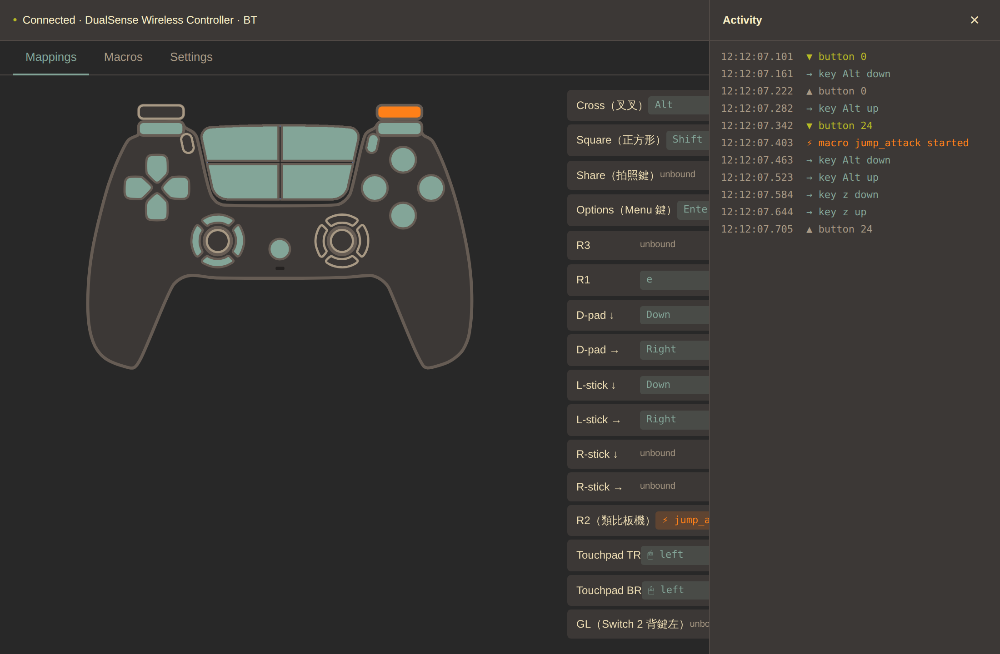

# DualSense Mapper

[English](README.md) | **繁體中文**

把 PS5 DualSense 控制器映射成鍵盤按鍵，讓筆電也能用手把玩。2025 年 5 月最初用 Python 寫成，為了讓我太太在 MacBook 上舒服地玩Maplestory Worlds Artale；後來用 Rust 重寫，打包成單一個 Windows 執行檔。

  
   
  直接點控制器圖上的按鈕就能綁定。按鈕名稱來自你的設定檔，可以改成任何你想要的字。

## 這工具給你什麼

- **點圖綁定，不必編輯 JSON。** 點控制器圖上的按鈕（或下方對應的那一列），選 Key / Macro / Mouse / Unbound。
- **29 個可映射輸入** —— 四個面板鍵、D-pad、左右蘑菇頭各四向、L1 / R1、L2 / R2 類比板機、L3 / R3、Share / Options / PS，再加觸控板四個象限。
- **觸控板可當滑鼠游標用**，帶兩段式加速曲線；四個象限各自是獨立的點擊綁定。
- **巨集延遲隨機化。** 每個步驟的延遲都是 `[min, max]` 區間，不存在固定節拍 —— 循環巨集不會被辨識成腳本特徵。
- **不會卡鍵。** 每一次合成按下都經過同一層帶引用計數的 safety 層；`Drop` 與 panic hook 保證即使 process 死掉，仍握著的鍵全部放開。
- **可以直接從 app 關掉控制器**（Windows）—— 送的是 Bluetooth link 層 disconnect，配對保留，按 PS 鍵就能重連，跟 PS5 主機一樣。
- **只有一個約 11 MB 的 `.exe`。** 不用安裝程式、沒有 DLL、沒有驅動、不做 process hooking —— 只用 user-mode `SendInput`。設定是首次執行時寫在 exe 旁邊的單一 JSON 檔。

## 介面一覽

<table>
  <tr>
    <td width="50%"></td>
    <td width="50%"></td>
  </tr>
  <tr>
    <td><b>綁定按鈕。</b>在圖上或清單裡點一顆按鈕，選 Key / Macro / Mouse / Unbound，按下想要的鍵，Save。立刻生效，不用重開。</td>
    <td><b>巨集。</b>一串按下／放開的步驟。每個延遲都是「最短～最長」的範圍，重複執行時節奏不會一模一樣。</td>
  </tr>
  <tr>
    <td></td>
    <td></td>
  </tr>
  <tr>
    <td><b>設定。</b>搖桿死區、扳機按多深算按下、隨機化的按鍵時間，以及觸控板游標。</td>
    <td><b>活動紀錄</b>（📊）。即時列出每次按下的按鈕、送出的鍵和啟動的巨集，進遊戲前可以先確認綁定對不對。</td>
  </tr>
</table>

截圖用的是示範設定，可用 <code>scripts/readme-shots.mjs</code> 重新產生。

## 怎麼取得

到 [latest release](https://github.com/Luotee/dualsense-mapper/releases) 下載 `dualsense-mapper.exe`，用藍牙配對手把，然後雙擊執行檔。完整步驟與按鈕對照表見 [`rust/README.md`](rust/README.md)（英文）。

## 兩套實作

| 目錄 | 狀態 | 對象 |
|---|---|---|
| `legacy-python/` | 可用，凍結作為參考 | 習慣 `pip install` 的開發者 |
| `rust/` | Phase 1（Windows），Phase 2（macOS）進行中 | 一般使用者 —— 單一 `.exe` |

推薦走 Rust 版。Python 版保留是為了 blame 歷史，也因為在 Phase 2 落地前它在 macOS 上仍可用。

## 支援的硬體

- **DualSense PS5 控制器**（`054c:0ce6`），走 **Bluetooth**。
- **Nintendo Switch Pro 控制器**（`057e:2009`），走 **Bluetooth**——請先在 Windows 的藍牙設定裡完成配對。
- **Nintendo Switch 2 Pro 控制器**，走 **Bluetooth LE**——第一次連線請按住小小的 SYNC 鍵；之後按任何鍵即可重新連線。**不要**在 Windows 藍牙設定裡配對（會斷線）。不映射模式（此手把的預設）需要安裝 [ViGEmBus 1.22.0](https://github.com/nefarius/ViGEmBus/releases/tag/v1.22.0)，遊戲會把它當成 Xbox 手把。建議使用 Windows 11（Windows 10 會被限制在約 17 Hz）。Switch 2 Pro 預設為不映射模式，因此按鍵綁定（含 GL/GR/C，id 30/31/32）要把 `mapping_enabled.ns2_pro` 設為 true 才會生效。`vigem_missing` 與 `ble_rate_limited_win10` 警告目前只出現在 controller-status 的 payload 與 log 裡，GUI 還不會顯示（隨 UX 改版加入）。若遊戲在不映射模式（預設）下收不到 Switch 2 Pro 的輸入，請安裝 [ViGEmBus 1.22.0](https://github.com/nefarius/ViGEmBus/releases/tag/v1.22.0)，或把 `mapping_enabled.ns2_pro` 改成 true。
- **連線震動**——app 開始使用某支手把時，它會短震一下。在 `dualsense-mapper.json` 把 `rumble_on_connect` 設為 false 即可關閉。

目前還不支援：

- DualSense 走 USB（延到 v2.0.1）。
- DualSense Edge（`054c:0df2`，延到 v2.0.1）。
- Xbox / 8BitDo / 一般 XInput 手把 —— v1.2.0 是最後一個帶 gilrs 泛用手把路徑的版本；v2.0.0 改成 DualSense 專用的 raw HID reader，好讓連線狀態、觸控板、IMU 與電量能直接從 78 bytes 的 HID report 讀出來。

## 為什麼有這個專案

現有的映射工具在負載高時會漏掉 key-release 事件，鍵就「卡住」了。Python 原型用三層 release-on-exit 防線解掉這件事，並做了延遲隨機化的巨集引擎，讓帶腳本味的輸入模式不會被線上遊戲標記。Rust 重寫版兩者都保留，另外修掉 Python 版兩個潛在 bug（板機 idle 值跨平台不一致；共用鍵的 release 衝撞），並打包給非技術使用者。

延伸閱讀：

- [`rust/README.md`](rust/README.md) —— 建置、執行、按鈕對照（英文）
- [`legacy-python/README.md`](legacy-python/README.md) —— 原始 Python 版說明（英文）
- [`CHANGELOG.md`](CHANGELOG.md) —— 各版本變更紀錄（英文）
